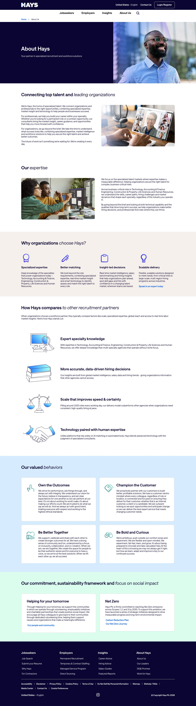
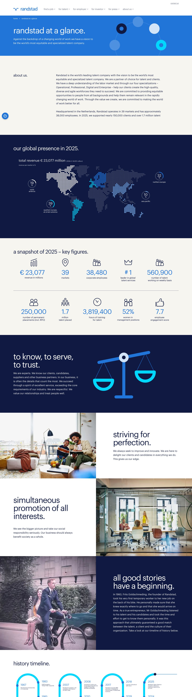
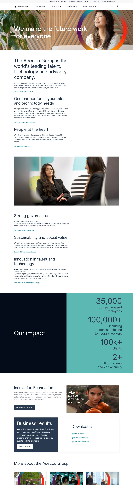
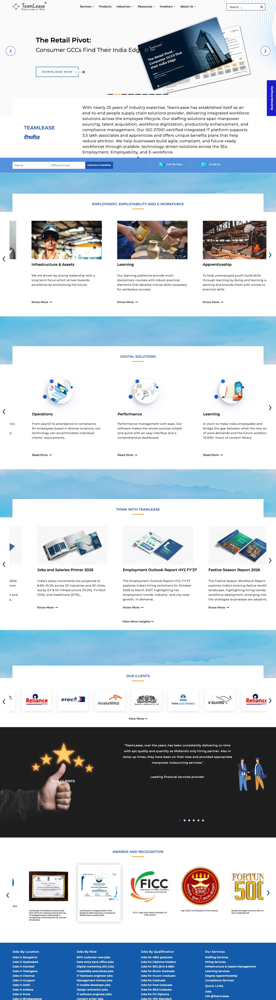
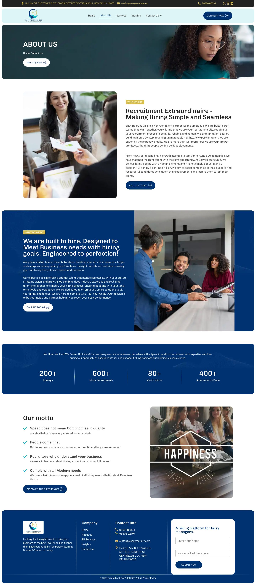

# Easy Recruitz 365 – About Us Page Redesign (3 Design Options)

A responsive redesign of the About Us page for **Easy Recruitz 365**, a recruitment and staffing firm based in New Delhi. The project delivers three alternative designs built from the same content, backed by research into how large staffing companies present themselves.

- Original page: <https://easyrecruiitz.com/about-us/>
- Status: **design mock-up** (not a production site)
- Stack: plain HTML, CSS and a little vanilla JavaScript. No build step, no dependencies.

---

## 1. Viewing the project

1. Clone or download the repository.
2. Open **`index.html`** in a browser. It shows the three designs side by side.
3. Open each design on a laptop, then on a phone (or narrow the browser window). All three are responsive.

You can also serve it locally with `python3 -m http.server` and open `http://localhost:8000`.

When a page opens, a short loader (logo and a thin progress line) plays for about 1.4 seconds before the content appears.

## 2. Thought process: how this was approached

The goal of the project is not just a prettier page. It is to show how a page like this should be **diagnosed, benchmarked, designed and verified**. The steps below are the order in which the work was done.

### Step 1. Understand the problem (diagnose before designing)
- Audited the live page as a visitor would see it (see [section 6](#6-audit-of-the-original-page)), not just its text.
- Lesson learned early: a text-only fetch of the page showed the four stats as "0 +", which looked like a bug. Rendering the page in a real browser showed the real numbers (200+, 500+, 80+, 400+). **Check the rendered page, not just the source.**
- Real problems found: inconsistent brand name, mismatched domain and email, dead buttons, four competing calls to action, buzzword copy, no proof, one off-brand stock photo.

### Step 2. Benchmark against stronger companies
- Studied the About pages of Hays, Randstad, Adecco and TeamLease, all far larger than the client, and saved screenshots in `docs/references/`.
- Looked for **patterns they share**, not for things to copy: one clear promise, early proof, real people, short copy, consistent icons, one primary action.

### Step 3. Define who the page is for (product thinking)
- A staffing firm has **two audiences**: employers who pay, and job seekers who supply the talent. The original page spoke to only one.
- Wrote down each audience's goal, main worry and primary action (see [section 8](#8-product-thinking-two-audiences-two-journeys)), then designed the page around the questions each one asks.

### Step 4. Decide the page structure
- Ordered the sections to answer visitor questions in sequence: *Who are you? What proof do you have? What do you do? How does it work? Why trust you? What do I do next?*
- Put the numbers right under the hero, kept one primary button, and made the process section a two-track tab so each audience sees its own journey.

### Step 5. Explore options instead of committing to one look
- Produced **three distinct directions** (Editorial, Corporate, Warm letter) from the same content, so reviewers react to a real choice and the decision is about brand fit, not taste in the abstract.

### Step 6. Iterate on feedback
- **Version 1 felt "AI-generated".** It had gradient text, emoji icons, glowing buttons, tilted cards and pill labels. It was removed completely.
- **Version 2** used solid colours, restrained typography, plain human copy, real photography and one consistent line-icon set.
- **The audience question in the contact form** first used a native browser dropdown. It looked like a generic template and did not match the design, so it became a two-button toggle that mirrors the tabs. A good idea (route two audiences) can be undermined by a generic control.
- **Circles looked as if they were in front of the person.** The bottom fade was applied to the photo only, so the lower body turned semi-transparent and the circle showed through at the waist. The fade now applies to the whole box, so the photo stays solid.
- **The circles looked odd and stiff.** A circle with a ring, drawn as a background, read as a flat sticker. Research into how professional sites animate shapes behind people pointed to a different approach: several separate shapes, each with its own size, colour, speed and depth, drifting slowly and reacting to scroll or cursor. The decoration was rebuilt that way, as four "orbs" behind each person, kept inside the photo box so they can never cover text.
- **The sticky header covered content on phones** and made the page look cropped at the top. It now slides away when scrolling down and returns when scrolling up.
- **A broken CSS rule** (a missing closing brace) made the stats icons 300 px wide and the page scroll sideways at laptop widths. It was found with a scripted check and fixed.
- **Small text was unreadable.** Design 1's section labels were about 12 px, grey and uppercase, so visitors could not read them. They were enlarged and darkened. Stylish micro-text fails real readers.
- **The chooser page is written for the client**, not for the designer. It explains why each option was designed that way and says "choose this if...", so the client can decide without a walkthrough.
- **Photos:** the first attempt cut people out of group photos and the edges were ragged, so the approach changed to single-person portraits on plain backgrounds. A white fringe then appeared around cutouts, which was fixed by shrinking the cutout mask and softening its edge.

### Step 7. Build decisions and why
| Decision | Reason |
|---|---|
| Plain HTML, CSS and JavaScript, no framework | Reviewers can open it by double-clicking. An About page is static content, so a framework adds no value here. It can be ported to React or the client's CMS later. |
| Mobile-first responsive layouts | Many candidates browse on phones. Checked at desktop width and a 500 px phone width. |
| Accessibility basics | Alt text on images, keyboard-operable tabs, visible focus, reduced-motion support for the loader. |
| Lightweight assets | Cutouts are WebP with transparency and the loader is a short (about 1.4 s) logo and progress line. |
| Real figures, labelled when unverified | Stats come from the original page and are flagged for client confirmation. Nothing was invented as a client name or testimonial. |

### Step 8. Verify, find bugs, be honest about limits
- Rendered every design at desktop and phone width and read the screenshots critically. This caught real bugs: a CSS class name clash that broke a section, cutouts cropped at the head, and a hero circle clipped at the top. All were fixed.
- Stat counters could not be exercised in headless Chrome, so the counter function was tested separately. Limits that remain are listed in [section 12](#12-known-limitations).

### Step 9. What would be done next (proposed, not yet measured)
If this went live, success would be judged by:
- Click-through on the hero button, split by employer vs job seeker.
- Contact form completion, split by the "I am" selector.
- Scroll depth to the "How it works" section, and bounce rate on the About page.
- A short round of user interviews (about five employers and five candidates) to test whether the two journeys are clear.
- An A/B test of the primary headline and button text.

## 3. Photo brief: what images the page needs and why

Photos carry most of the trust on a staffing site. The current set is stock and is repeated across designs, which is a weakness. This brief says what to shoot or source, in priority order, and where each photo goes.

**Principle:** the strongest page uses **real photos of the real team**, then well-chosen stock for audiences the team cannot represent. Stock is a stand-in, not the goal.

| Priority | Photo | Why it is needed | Used in | Spec |
|---|---|---|---|---|
| **P1** | **The real team** (group, and 2 to 3 individual portraits of recruiters) | Biggest trust builder. Visitors want to see who will call them | Hero, Who we are, Design 3 team figure | Real people with written consent. Natural light, plain or office background. Group landscape plus single portraits |
| **P1** | **Founder or lead recruiter portrait**, with a one-line quote | Puts a human face and accountability on a small firm | Who we are | Head and shoulders, looking at camera, plain background |
| **P1** | **Employer persona**: a hiring manager or startup founder, smart casual, 30 to 45 | Represents the paying audience in the "I'm hiring" journey | Hero, "I'm hiring" tab | Single person, plain light background, torso to knees |
| **P1** | **Job seeker persona**: young professional with a resume or laptop | Represents the candidate in the "I'm looking for a job" journey | Hero, "I'm looking for a job" tab | Same as above |
| **P2** | **A second job seeker**: experienced professional, 30 to 40 | Shows range. Candidates are not only freshers | "I'm looking for a job" tab | Single person, plain background |
| **P2** | **Operations / frontline workers**: retail, warehouse or factory staff | **Content gap.** Mass recruitment and temporary staffing serve these roles, but every current photo is an office suit | What we do (mass and temporary staffing) | Group or single, real work setting or plain background |
| **P2** | **The office**: Jasola entrance or reception | Proves the firm is real and has an address | Contact section | Landscape, daylight, no stock lobby |
| **P3** | **A "joining day" moment**: a new hire being welcomed | Shows the outcome the firm sells, not the process | Process section or stats area | Candid, natural, with consent |
| **P3** | **Client logos** (not photos) | Strongest proof after real people | Below the stats | Only with written permission |

**Technical spec for all photos**
- At least **1,200 px on the longest side** (the current low-resolution ones look soft on large screens).
- For cutouts: **one person, plain light background, even lighting, no overlapping props or text, no watermark.** Keep hair and shoulders fully in frame.
- One consistent style across the set (same lighting, colour feel and framing) so the page looks designed, not assembled.
- Mixed, realistic representation. Avoid overly staged "stock smile" poses and any images with text overlays.
- Supply JPG or PNG. Name files by role, for example `employer-founder.jpg`.

**If a shoot is not possible:** a short phone-camera session of the team against a plain wall in daylight gives better trust than stock. Use licensed stock only for the P2 audiences and replace it as real photos arrive.

## 4. Repository structure

```
index.html              Chooser page linking to the three designs
designs/
  1-editorial/          Design 1
  2-corporate/          Design 2
  3-warm/               Design 3
shared/
  script.js             Mobile menu, loader, stat counters, demo form
  loader.css            Page loader styles
  process.css           Two-track "How it works" tabs (employers / job seekers)
  motion.css            Scroll reveals, moving orbs behind people, services strip, progress line, call button
  proposal.css          Thin "design proposal" bar shown above each option
assets/
  logo-hd.png           Company logo (upscaled 3x and sharpened)
  people/               Cutout photos (transparent background)
docs/references/        Screenshots of the reference About pages
```

## 5. The three designs

| | 1 – Editorial | 2 – Corporate | 3 – Warm letter |
|---|---|---|---|
| **Look** | Off-white, serif headlines, thin rules, people standing directly on the rules | Navy hero with two people, large numbers, bordered grid | Cream paper, one narrow reading column, timeline and FAQ |
| **Feels like** | A premium consultancy or a good magazine | Hays, Randstad, TeamLease | A personal introduction from a real team |
| **Best if** | The client wants to look established and trustworthy | The client wants a large-company staffing look | The client wants a human, approachable voice |

All three share the same content. They differ in layout, typography, colour and photo placement. Each includes a responsive navigation menu, the loader, a consistent set of line icons, animated stat counters, a two-track "How it works" section and a demo contact form.

## 6. Audit of the original page

Screenshot: [`docs/references/easy-recruitz-current.jpg`](docs/references/easy-recruitz-current.jpg)

| Issue | Why it matters |
|---|---|
| The brand name is written several ways (*Easy Recuitz*, *Easy Recruitz 365*, *EasyRecruitz*) | Weak brand identity |
| The site runs on `easyrecruiitz.com` (double *i*) but the email uses `easyrecruitz.com` | Looks like a typo and risks misdirected email |
| Several buttons link to `#` | Dead calls to action |
| Four competing buttons ("Get a quote", "Connect Now", "Call us Today!", "Contact us today") | Visitors do not know what to do next |
| Long paragraphs full of buzzwords ("Nex-Gen", "Engineered to perfection") | Hard to read, no proof behind the claims |
| No client names, case studies or testimonials | Claims are not backed up |
| An off-brand "HAPPINESS" stock photo | Looks unprofessional |
| Images have no alt text | Accessibility and SEO |

The original page's stats (taken from the rendered page) are **200+ Joinings, 500+ Mass Recruitments, 80+ Verifications and 400+ Assessments Done**. The new designs use the same figures. The client should confirm them.

## 7. Market research

The reference companies are all much larger than Easy Recruitz. Randstad, Adecco and Hays are global listed companies, and TeamLease is the largest listed staffing company in India.

### Reference pages

| Company | Page | Screenshot |
|---|---|---|
| **Hays** (UK) | [hays.com/about-us](https://hays.com/about-us) |  |
| **Randstad** (Netherlands) | [randstad.com/randstad-at-a-glance](https://www.randstad.com/randstad-at-a-glance/) |  |
| **The Adecco Group** (Switzerland) | [adeccogroup.com/who-we-are](https://www.adeccogroup.com/who-we-are) |  |
| **TeamLease** (India) | [group.teamlease.com](https://group.teamlease.com/) |  |
| **Easy Recruitz (original)** | [easyrecruiitz.com/about-us](https://easyrecruiitz.com/about-us/) |  |

The screenshots belong to the respective companies. They are included for comparison and reference only.

### What each reference does well, and what we took from it

| Company | Scale (per their own pages) | Strengths | Applied here |
|---|---|---|---|
| **Hays** | 50+ years, roughly 1,000 roles filled every working day | Short headings with one italic keyword, real people photography, icon cards, a single primary call to action | Design 2: people in the hero, icon grid |
| **Randstad** | 39 markets, about 38,000 employees, nearly 150,000 clients (2025) | Rhythmic lowercase headlines, **key figures with icons**, founder story and timeline | Designs 1 and 2: icon above a large number. Design 3: storytelling tone |
| **Adecco** | 100,000+ clients, 60+ markets | Generous whitespace, one narrow column of short blocks, plain direct copy | Designs 1 and 3: whitespace and reading width |
| **TeamLease** | About 25 years, 10,000+ placements a month | **Cutout photos** on colour backgrounds, service cards with icons, client logos and awards | All designs: cutout people on colour panels |

### Patterns shared by all of them
1. One clear promise at the top, not a wall of text.
2. Numbers early, usually with icons.
3. Real people in photos, placed deliberately next to short text.
4. Short headings, one idea per block, plenty of whitespace.
5. A consistent icon style.
6. Trust signals such as clients, awards and legal details.
7. One primary call to action, repeated.

## 8. Product thinking: two audiences, two journeys

A staffing firm's website has two very different visitors, and the original page only spoke to one of them (employers). The original site's own menu has separate **Employer** and **Employee** entries, so both audiences are real.

| | **Employer / hiring manager** | **Job seeker / candidate** |
|---|---|---|
| Goal | Fill a role quickly with someone who is verified | Find a suitable role and get through the process |
| Main worry | "Will I waste time on poor profiles?" | "Is this a real opportunity and what happens next?" |
| What they need to see | Proof (numbers), process, who does what | A clear first step and what to expect |
| Primary action | **Talk to a recruiter** | **Share your resume** |

How this shows up in the design:
- **The hero has one primary button for the paying customer** ("Talk to a recruiter") and a clear secondary link for candidates ("Looking for a job?"), which jumps to the right journey.
- **"How it works" is a two-tab section** ("I'm hiring" / "I'm looking for a job"). Each tab has its own photo, four steps and call to action. Without JavaScript both journeys are shown one after the other.
- **Every step is tagged "You" or "Us"**, so each visitor immediately sees what they have to do and what the firm does. This reduces anxiety about effort.
- **The contact form has a two-button toggle ("I'm hiring" / "I'm looking for a job")** instead of a native dropdown, and the call-to-action buttons pre-select the right answer. The team can route enquiries without reading each message.
- **The tabs are keyboard accessible** (arrow keys switch tabs) and use proper ARIA roles.

Journeys as designed:

| Step | Employer | Job seeker |
|---|---|---|
| 1 | Tell us what you need (**You**) | Send us your resume (**You**) |
| 2 | We search and screen (**Us**) | We match you to roles (**Us**) |
| 3 | We verify (**Us**) | Assessment and verification (**Us**) |
| 4 | Interview and hire (**You**) | Interview and join (**You**) |

The job-seeker steps are a sensible default built from the services the firm already lists (verification, assessments, joining support). The client should confirm the real candidate process before launch.

## 9. Page structure and UX reasoning

The page answers the questions a hiring manager asks, in the order they ask them.

| # | Section | Question it answers |
|---|---|---|
| 1 | **Hero**: headline, photo, one button | "Who are these people and are they relevant to me?" |
| 2 | **Numbers** (200+, 500+, 80+, 400+) | "What proof do they have?" |
| 3 | **Who we are** | "What kind of firm is this?" |
| 4 | **What we do** (four services with icons) | "What would I get?" |
| 5 | **How we work** (four steps) | "What is the process and what is the risk?" |
| 6 | **Motto / values** | "Why should I trust them?" |
| 7 | **Contact and form** | "What do I do next?" |

Placement decisions:
- **Numbers sit right under the hero**, so the proof appears before the visitor scrolls, as on the reference sites.
- **One primary button** ("Talk to a recruiter" / "Get a quote") is repeated. Everything else is a text link.
- **Photos alternate with text** (left and right) so the page does not feel monotonous.
- **Cutouts stand directly on the page, without boxes.** Design 1 anchors each person to a thin rule, Design 2 fades the cropped edge out and puts overlapping circles behind the person, and Design 3 keeps a warm panel behind the team photo. Removing the box makes the people feel part of the page rather than pasted into it.
- **On phones the layout collapses to one column** with large tap targets and a hamburger menu.
- **The loader is short** (about 1.4 seconds) so it never makes visitors wait.

## 10. Original page vs the new designs

| Aspect | Original | New designs |
|---|---|---|
| Hero | A plain "About Us" title bar | Clear promise, photo and a single button |
| Photos | Mixed stock images, one off-brand | Cutout people on colour panels |
| Icons | None | One consistent line-icon set (services and stats) |
| Copy | Long, buzzword-heavy paragraphs | Short, direct and concrete |
| Buttons | Four competing | One primary |
| Stats | Present | Same numbers, with icons |
| Process steps | None | Two tracks (employer and job seeker) with "You / Us" tags |
| Audience routing | One audience only | Hero link, tabs and a form toggle for both |
| FAQ | None | Included in Design 3 |
| Loader | None | Included |
| Client logos and testimonials | None | **Still none** (real data needed) |

## 11. Product review and decision log

An honest review of the work from a product point of view: what works, what is missing, and what the recommended next steps are.

### What works
- **The audience split is visible in four places:** hero link, "How it works" tabs, "You / Us" step tags and the contact form toggle.
- **Proof sits right under the hero**, as on the benchmark sites.
- **One primary action** for the paying customer, with a clear secondary path for candidates.
- **The chooser page gives the client a decision**, with reasoning for each option and a list of what is needed to finish.

### Gaps and recommended next steps

| # | Gap | Why it matters | Recommendation | Effort | Needs decision from |
|---|---|---|---|---|---|
| 1 | The job-seeker journey has no real destination. "Share your resume" opens a contact form | Candidates are the supply side of the business. Without a real path they leave | Add a resume upload, a WhatsApp number or a link to a jobs page | Medium (needs a backend) | Client and developer |
| 2 | The hero speaks to employers first and the candidate link is small | A candidate may not realise the page is also for them | Option: two equal "doors" under the hero ("I'm hiring" / "I'm looking for a job"). Trade-off: it dilutes the focus on the paying customer | Small | Client (business priority) |
| 3 | No social proof (client logos, testimonials, awards) | The strongest trust signal after real people. Every benchmark site has it | Collect three to six client logos and two or three short testimonials, with permission | Small, depends on the client | Client |
| 4 | Photos are stock stand-ins | Real people build the most trust | See the photo brief in section 3 | Medium | Client |
| 5 | The numbers have no date or time frame | Randstad dates its figures. Undated numbers feel less credible | Add "since [year]" or "as of [month year]" | Tiny | Client |
| 6 | No quick contact on mobile beyond the form | Many Indian users prefer calling or WhatsApp to filling forms | A sticky "Call" or WhatsApp button on phones | Small | Client |
| 7 | The page does not say which industries or cities are served | Employers ask "do you hire for my sector?" | Add an "Industries we hire for" row (needs real data) | Small | Client |
| 8 | No measurement is wired up | Without data the page cannot be improved | Track hero button clicks by audience, tab switches and form submits by toggle choice | Small | Developer |

Items 5 to 7 are product suggestions based on common practice, not findings from user research. They should be validated with the client and a few real users.

### Decision log

| Decision | Alternatives considered | Why this choice | Trade-off |
|---|---|---|---|
| Three design options | One "best" design | Lets the client react to a real choice, so the decision is about brand fit | More work, and the client has to choose |
| Plain HTML, CSS and JavaScript | React or another framework | An About page is static content. It opens with a double-click and needs no build | A framework would help only if the live site is already built with one |
| Tabs for the two journeys | Two separate sections, or two separate pages | Keeps the page short and gives each audience a focused view | Hidden content is less discoverable, so the hero link and a no-JavaScript fallback (both journeys shown) compensate |
| Employer is the primary hero action | Equal weight for both audiences | The employer pays, so that action is the business priority | Candidates get a smaller entry point (see gap 2) |
| Toggle in the form | Native dropdown, or two separate forms | Matches the tabs, is faster to use and shows both options at once | Slightly more code than a dropdown |
| Cutout people with no background box (Designs 1 and 2) | Cutouts on coloured panels, or full rectangular photos | Without a box the people look integrated and slightly three-dimensional. Each design handles the cropped edge differently: Design 1 sits it on a rule, Design 2 fades it out (a drop shadow was tried and removed because it left a faint box around the cutout) | Needs clean source photos, and cropped cutouts need a deliberate edge treatment |
| Real figures from the original page | Placeholder numbers | Placeholders look fake. The real ones are already public | The client must confirm them |
| No invented client names or testimonials | Realistic-looking fake ones | Fake proof is dishonest and can damage the client | The page has less social proof until real data arrives |
| Moving orbs behind people (four shapes per photo, scroll and cursor parallax, slow float) | One flat circle, or a static background | Layered shapes with different speeds and depth feel alive without distracting, which is how large sites use motion. Each design keeps its own mood: Editorial is calm, Corporate is bolder, Warm morphs its largest shape | More code. Motion can distract or exclude, so it pauses when off screen, stops for visitors who prefer reduced motion, and content stays visible without JavaScript |
| Scroll reveals, a reading-progress line and a services strip | No motion | Gives a sense of progress and of what the firm covers. The strip uses real content from the current site instead of placeholder client logos, which would be dishonest | It is not a substitute for real client logos, which are still missing |
| Header hides on scroll down on phones | Always-visible sticky header | A tall sticky bar uses a large part of a small screen | Visitors must scroll up slightly to reach the menu |
| A "Call us" button on phones | Form only | Many phone visitors prefer to call, and it costs one tap | The number is from the current website and must be confirmed |
| Mock-up scope: no security hardening | Production-grade hardening | The request was for a design mock-up. Hardening belongs to the production build | The form is a demo and must be rebuilt for production |

## 12. Known limitations

- **Photos are placeholders for the mock-up.** Three of the people photos were supplied by the project owner and the rest were found online. None are confirmed as licensed for production. Some may be AI-generated and one has a faint watermark pattern. Replace them with licensed images or photos of the real team before launch.
- **Cutouts were generated automatically** with the macOS Vision framework. A designer should retouch them for production.
- **The contact form is a demo.** Nothing is submitted anywhere.
- **Copy is partly new.** The service descriptions, FAQ answers, "What we believe" text and the job-seeker steps are written from the original site's wording and need client approval.
- **Brand spelling is unresolved.** The logo reads "RECRUIITZ" (double *i*) while the email domain uses "recruitz". The client needs to confirm the correct form.
- **The logo is low resolution** (508 × 306 px). `logo-hd.png` is a 3x Lanczos upscale with sharpening, not an AI upscale. Ask the client for the original vector file.
- **Motion was checked by script, not by eye in every browser.** In Chrome, a script confirmed that the orbs are created, that they move with the cursor, and that nothing stays hidden or throws errors. Smoothness, speed and taste still need a human look, and it has not been tried on a physical phone.
- **Responsive testing is only partly complete.** An earlier scripted check across screen widths (320 to 1920 px) found the problems listed in section 2, which were fixed. After the orbs and the phone header change were added, the full width-by-width check was **not run again**. Please resize the browser and test on a phone before presenting.
- **Menu links do not go anywhere yet.**
- **Testing:** checked in desktop Chrome and a 500 px wide mobile layout through screenshots. It has not been tested on physical phones, and the stat counters could not be exercised in headless Chrome (the counter function itself was tested separately).

## 13. Pre-launch checklist

- [ ] Licensed or real team photos
- [ ] Confirm brand spelling and domain
- [ ] Confirm the stats
- [ ] Confirm the real job-seeker process (and whether candidates need a resume upload form)
- [ ] Add client logos and testimonials (with permission)
- [ ] Connect the contact form to a real email or CRM endpoint
- [ ] Link the menu to real pages
- [ ] Obtain the original HD or vector logo

## 14. Sources

- Original page: <https://easyrecruiitz.com/about-us/>
- Hays: <https://hays.com/about-us>
- Randstad: <https://www.randstad.com/randstad-at-a-glance/>
- The Adecco Group: <https://www.adeccogroup.com/who-we-are>
- TeamLease: <https://group.teamlease.com/>
- Staffing website roundups: [CyberOptik](https://cyberoptik.net/blog/20-best-staffing-websites), [Colorlib](https://colorlib.com/wp/staffing-agency-website-examples/)

Figures for the reference companies are quoted as published on their pages at the time of research (October 2026) and may change.
